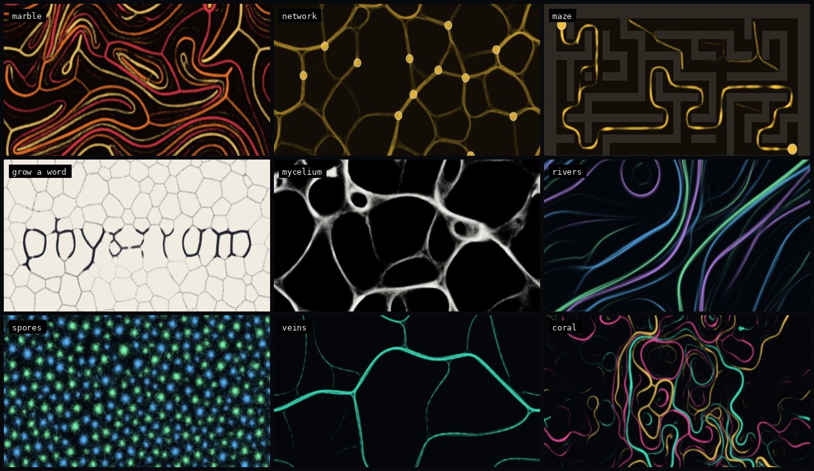
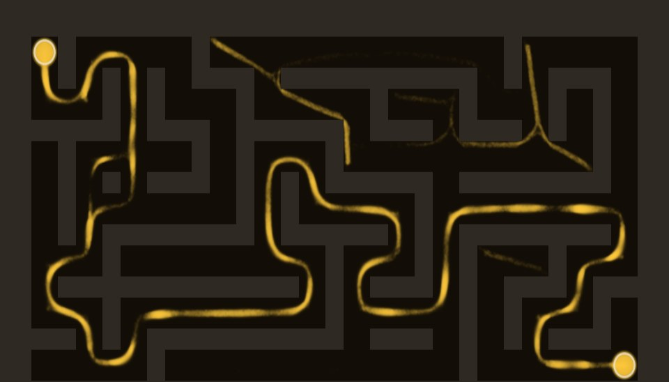

# physarum

A slime mold simulator in a single HTML file. Hundreds of thousands of agents each follow three rules: smell the trail ahead, turn toward the strongest scent, step forward and leave some scent behind. That's enough to grow veins, honeycombs, braided rivers and transport networks. It can also solve mazes and grow words, the way real *Physarum polycephalum* does on an agar plate.



## Run it

Open `index.html` in a browser. There's no build step and nothing to install.

Start with a preset, or press `x` until something good shows up. Every change goes into the URL, so **copy link** shares exactly what's on screen. That includes the maze or word, because those are rebuilt from a seed stored in the link.

**Things to try**
- **maze**: the slime floods every corridor, then the dead ends wither until only the shortest route between the two food sources is left.
- **network**: food sources get linked by tubes. Drag more food around and watch the network reroute.
- **grow a word**: type something in the panel and the slime grows into the letters.
- **drop an image** onto the canvas: bright areas become fertile ground and you get a slime-mold portrait. Mostly-light images are inverted automatically.
- **record**: press `v` to capture a webm of whatever is happening.

| input | does |
|---|---|
| drag | paint with the current brush: food, wall or erase |
| right-drag / shift-drag | erase |
| `1` `2` `3` | food / wall / erase brush |
| `space` | pause (painting still works while paused) |
| `f` / `m` / `c` | scatter food / new maze / clear the scene |
| `r` | reseed agents and keep the scene |
| `x` | random organism |
| `h` | toggle panel (also the ≡ button) |
| `s` / `v` | save PNG / start or stop a video recording |



## How it works

**Agents.** Each agent has a position, a heading and a species. Every step it samples the trail at three sensors (ahead, and `sensor angle` to either side, `sensor dist` pixels out). It turns toward the strongest reading, moves `step size`, and deposits `deposit` into its species' channel, but only if the move succeeded. The trail is then blurred 3×3 and multiplied by `trail decay`. With several species, an agent reads `own − repulsion × others`, so species carve out separate territories. This is Jeff Jones's 2010 Physarum transport model.

**The field.** Food, walls and "barren ground" live in one RGBA field that's painted on the CPU and uploaded to the GPU in dirty rectangles.
- **Food** adds scent to the trail every step.
- **Walls** block movement, read as strongly negative to the sensors, and soak up any trail.
- **Barren ground** makes trails decay faster, so tubes can't survive there. That's how words and images work: the letters are the only place tubes can last.

**Solving mazes.** A trail-following agent can't tell a dead end from the way out, so the maze uses a second model running alongside the agents: Tero et al. (2007), the "Physarum solver". The maze is treated as a graph of tubes with conductivity *D*. Every frame:
1. A Gauss–Seidel solve of Kirchhoff's equations finds the pressure field for a unit flow between the two food sources.
2. Each tube updates by `dD/dt = |Q| − D`. Tubes carrying flow thicken; idle tubes shrink.

This provably converges to the shortest path. The test suite checks that the surviving tubes match a BFS shortest path exactly. Conductivity is fed back to the agents in two ways: they're attracted to it, and trails starve where it's low. So the visible slime retracts the same way the real organism does. Mazes have about 12% extra walls removed, so there are loops and real alternative routes to choose between.

**WebGL2 path (default)**
- Agent state is an `RGBA32F` texture, updated by a fragment shader that ping-pongs between two copies. The sign of the species field marks agents that were blocked this step.
- Deposits are 1-px `gl.POINTS`, additively blended into an `RGBA16F` trail map with one channel per species.
- A single full-screen pass handles diffusion, decay, food emission, walls, barren ground and maze starvation. It also writes `total²` into alpha.
- Auto-exposure comes from `generateMipmap`: the 1×1 top mip gives `E[t]` and `E[t²]`, and their ratio is an intensity-weighted mean. Sparse scenes don't blow out and dense ones don't go muddy.

**CPU fallback**: used when `EXT_color_buffer_float` is missing. It's the same model on typed arrays at half resolution, with a cosine/sine lookup table and separable box blur.

On an Intel i7-1255U iGPU: ~760k agents at 1920×1000 in ~4 ms per step. The CPU fallback runs ~50–60k agents at 30–60 fps, depending on the species count.

## Tests

```sh
node test/e2e.mjs        # WebGL2 engine
node test/e2e.mjs --cpu  # CPU fallback (launches with --disable-webgl)
```

The test drives headless Chromium over the DevTools protocol, using Node 22's built-in WebSocket, so there are no dependencies. With real mouse and keyboard input it checks presets, the URL round-trip, painting food and walls (including while paused), maze determinism, that the Tero solver lands on the true shortest path, word growing, video recording and console errors. Screenshots go to `test/out/`. Set `CHROME=/path/to/chrome` if `chromium-browser` isn't on your PATH.
